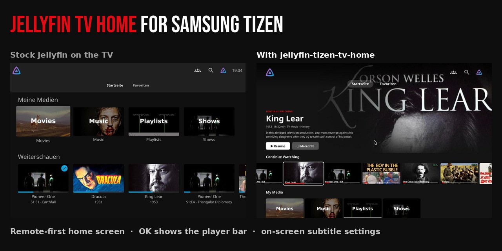
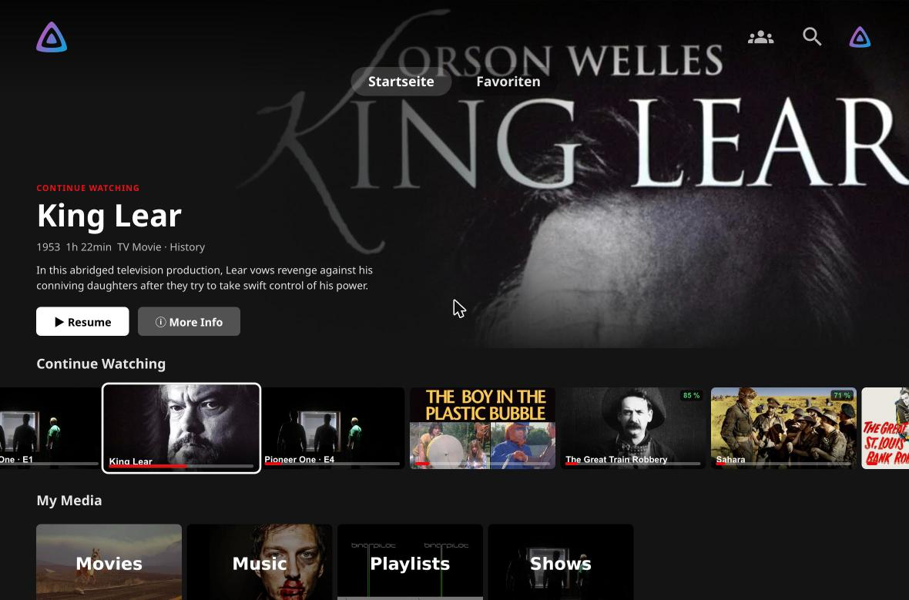
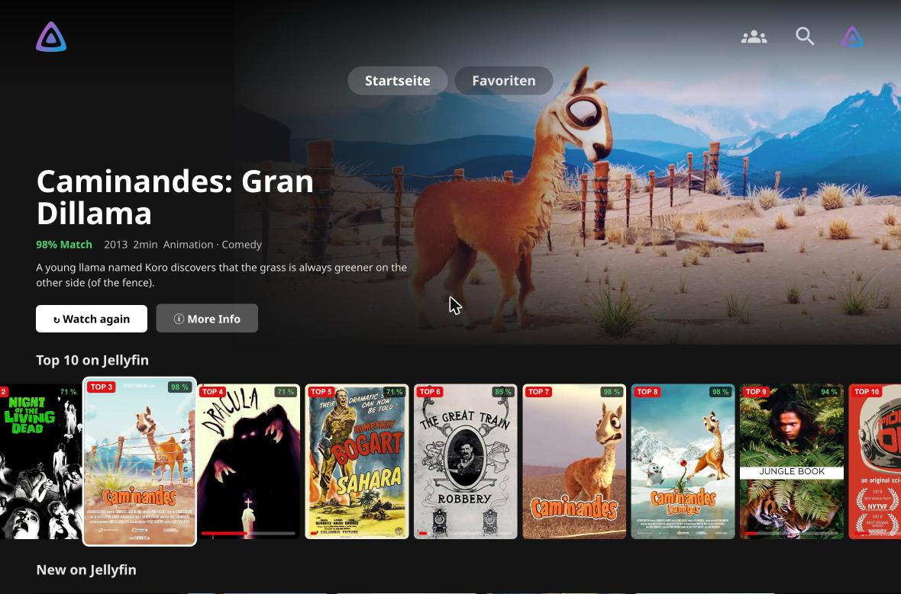
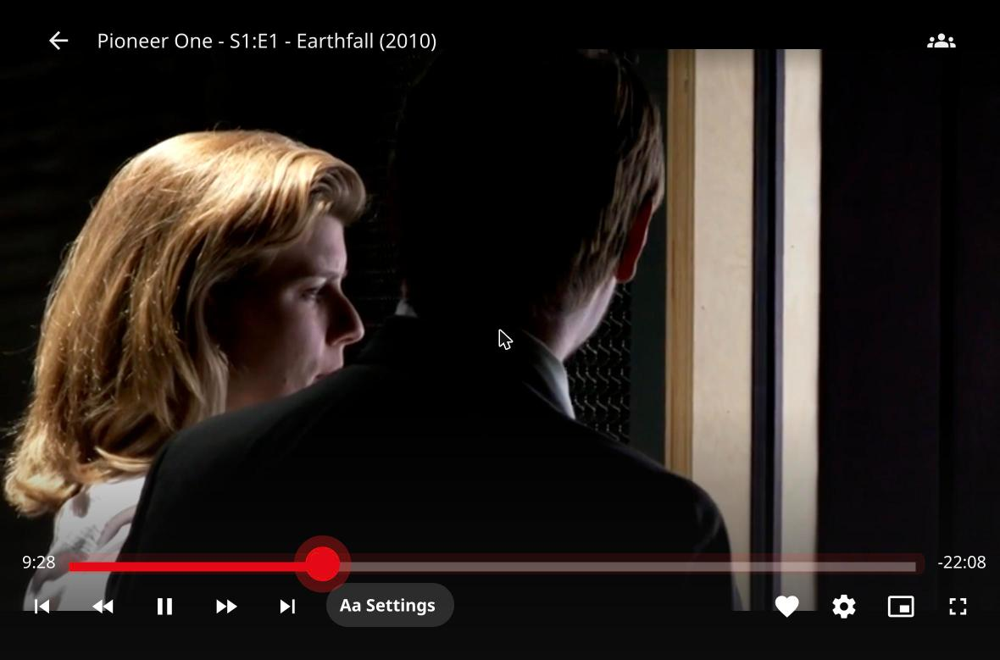
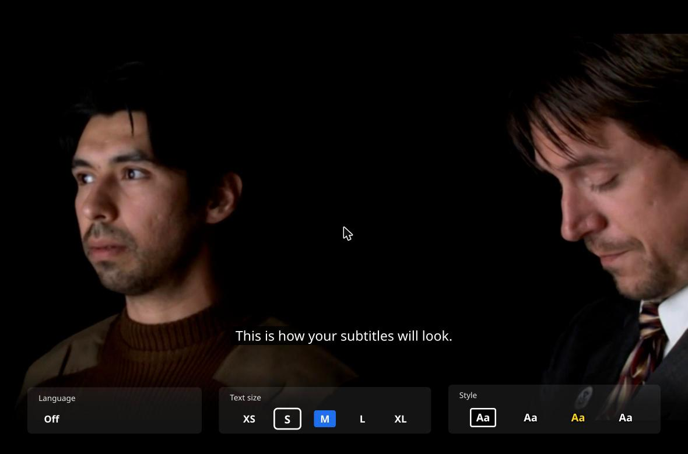
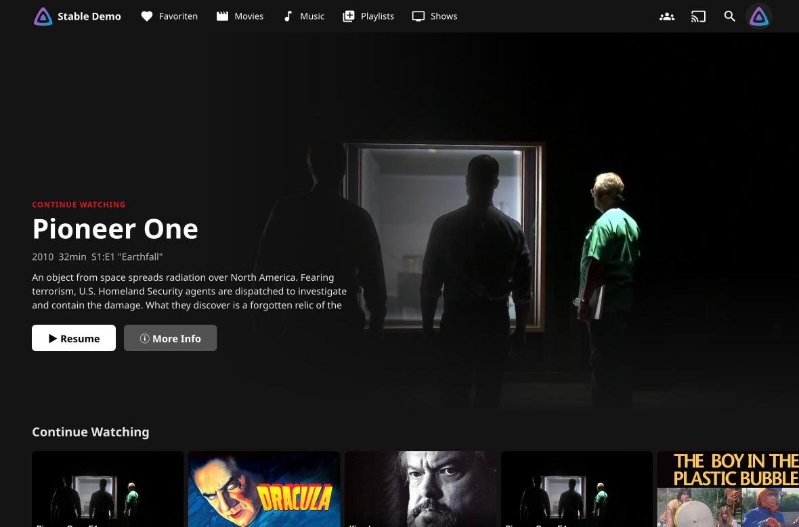

<div align="center">

# Jellyfin TV Home for Samsung Tizen

**A streaming-style home screen, a calmer player and on-screen subtitle settings for Jellyfin on Samsung TVs.**
Built for the remote, tested on a Samsung The Frame (2022, Tizen 6.5), and still nice in the browser, on iPad and on phones.



No fork of Jellyfin · no server patching · two small scripts and one CSS file · MIT

</div>

---

## Why this exists

We put Jellyfin on our Samsung The Frame for the family, and the stock TV experience fell short in a few practical ways:

- **The remote fought the UI.** Rows overlapped, focus jumped around, scrolling left and right was slow and sometimes stuck. You could not reliably get to the item you wanted.
- **Pressing OK paused the movie.** Most people press OK just to see how much time is left. On the TV that stopped playback.
- **Subtitles were too small or too big, and could only be changed in a settings page deep in the menu.** Not something you do from the couch in the middle of a film.
- **Visual glitches on Tizen:** a purple tint and "ghost" images of the home screen behind the video, plus a header that was cut off at the top of the 1920×1080 canvas.

The existing Jellyfin themes (great ones are listed below) restyle Jellyfin with **CSS**. That makes it prettier, but CSS cannot change how the **remote navigates**, what **OK** does in the player, or add a **settings bar**. This repo adds that missing JavaScript layer, and it's designed so you can keep using your favourite theme alongside it.

## What you get

| | |
|---|---|
|  | **Remote-first home screen.** Big hero with backdrop, title, rating, runtime and *Resume / Play* + *More Info*. Rows underneath, which you move through with the arrow keys. The layout is fixed to the TV canvas, so nothing overlaps or jumps. Only the visible cards load their images, so it stays fast on a 2022 TV. *Back* always returns to the hero. |
|  | **Dynamic rows, computed from your own watch history:** *Continue Watching* (resume + next up), *My Media* (all libraries), *Top 10*, *Because you like {genre}*, *Collections*, *New on {your server}*, *More {genre} for you*, a row per library with a *Show all* card, and *Watch Again*. Each card gets a **match score** from a genre profile of what you actually watched. |
|  | **OK shows the player bar instead of pausing.** You can then decide whether to pause, seek or just check the remaining time. The seek bar and the focused buttons get a strong, clearly visible highlight on the TV. The subtitle button moves next to the transport controls, so it's one press away. |
|  | **On-screen subtitle settings** (press ▼ while watching): language, five sizes (XS–XL) and four styles (box, shadow, yellow, outline), with a **live preview** on the running video. OK saves, Back discards. Stored per device, so it survives app restarts. |
|  | **Same home screen on desktop, iPad and phones,** with mouse hover, scroll arrows and touch scrolling. Each platform gets its own layout: TV, desktop and mobile. |

Plus:

- **Optional TV intro.** A ~3.7 s wordmark animation with an original sound (included, CC0), shown before the app starts.
- **English and German built in.** The scripts follow the Jellyfin UI language, or you can force one.
- **Privacy-friendly.** No external requests, no tracking and no CDN fonts. Everything runs against your own server's API.

## How it compares

Honest version: **full TV clients such as [Moonfin](https://github.com/Moonfin-Client/Smart-TV) do more overall.** They have their own player, Live TV, Seerr and libass subtitles. **[Jellyfin-Enhanced](https://github.com/n00bcodr/Jellyfin-Enhanced)** adds far more browser features: shortcuts, reviews, requests and subtitle presets. This repo does something none of them do: it makes the **official** Jellyfin app on a Samsung TV feel good with the remote, without replacing the app and without leaving the Jellyfin web stack.

| | CSS themes ([Apollo](https://github.com/DPilat-Dev/Apollo), [Cinema](https://github.com/gauthier-se/jellyfin-theme-cinema), [Netflin](https://github.com/ahza-code/Netflin)) | [Jellyfin-Enhanced](https://github.com/n00bcodr/Jellyfin-Enhanced) | Separate TV clients ([Moonfin](https://github.com/Moonfin-Client/Smart-TV), [Litefin](https://github.com/MoazSalem/litefin/)) | **This repo** |
|---|:---:|:---:|:---:|:---:|
| Stays the **official** Jellyfin app (all server features, same updates) | ✅ | ✅ | ❌ own app | ✅ |
| Runs inside the official **Samsung Tizen** app | CSS only | ❌ not without a patch | – | ✅ via `patch-wgt.py` |
| Home screen built for **remote navigation** (fixed layout, no overlap, lazy images) | ❌ | ❌ | ✅ | ✅ |
| Dynamic rows from your **own watch history** + match score | ❌ | ❌ | partly | ✅ |
| **OK shows the player bar** instead of pausing | ❌ | ❌ | ? | ✅ |
| Subtitle size/style **on the TV with live preview** | ❌ | browser panel | ✅ | ✅ |
| Fixes for Tizen purple tint, ghost images, clipped header | ❌ | ❌ | n/a | ✅ |
| Change once on the server, every TV updates — **no reinstall** | ✅ | ✅ | ❌ | ✅ |
| Lets **other** JavaScript Injector scripts run on the Samsung TV too | – | – | – | ✅ |

The last row is a nice side effect: once the TV app loads your server's public script bundle, other public JavaScript Injector scripts run on the TV as well.

## Install

You need Jellyfin **10.11 or 12** and the **[JavaScript Injector](https://github.com/n00bcodr/Jellyfin-JavaScript-Injector)** plugin by n00bcodr. Steps 1–3 already give you everything in the browser. Step 4 is only needed for the Samsung TV.

### 1. Install the JavaScript Injector plugin

Dashboard → Plugins → Repositories → add the manifest for your version from the [plugin's README](https://github.com/n00bcodr/Jellyfin-JavaScript-Injector). Then install **JavaScript Injector** from the catalogue and restart Jellyfin.

### 2. Add the two scripts

Dashboard → Plugins → JavaScript Injector → *Add script*:

| Name | Content | "Requires authentication" |
|---|---|---|
| TV Home | [`scripts/tv-home.js`](scripts/tv-home.js) | **off** |
| TV Player | [`scripts/tv-player.js`](scripts/tv-player.js) | **off** |

"Requires authentication = off" puts the scripts into the plugin's **public** bundle (`/JavaScriptInjector/public.js`). The TV app loads that bundle in step 4. The scripts contain no secrets. They only talk to the API with the session of whoever is signed in.

Optional settings sit at the top of `tv-home.js`:

```js
var CONFIG = {
  brand: 'Jellyfin',            // "New on Jellyfin", "Top 10 on Jellyfin"
  language: 'auto',             // 'auto' | 'en' | 'de'
  spotlightCollectionId: '',    // a collection whose items feed the hero + Top 10 (default: best rated)
  hiddenLibraries: [],          // e.g. ['Home Videos'] – no own row, not in "My Media"
  hiddenPathRegex: null,        // e.g. /Home Videos|Private/i – never recommended
  heroIntervalMs: 9000
};
```

### 3. Add the CSS (recommended)

Dashboard → General → Branding → *Custom CSS*: paste [`css/custom.css`](css/custom.css).
It contains the dark look, the **Tizen fixes** (purple tint, ghost images, clipped header) and the player focus styles. Sections are numbered, so you can drop the look (section 1) if you prefer another theme and keep only the fixes.

### 4. Samsung TV: load the scripts in the TV app

The official [Jellyfin for Tizen](https://github.com/jellyfin/jellyfin-tizen) app ships its own copy of the web UI, so it **does not** run plugin scripts on its own. [`tools/patch-wgt.py`](tools/patch-wgt.py) adds one `<script>` tag pointing to your server. From then on, every script change on the server reaches the TV with no reinstall.

```bash
# get a Jellyfin.wgt, e.g. from https://github.com/jeppevinkel/jellyfin-tizen-builds
python3 tools/patch-wgt.py Jellyfin.wgt Jellyfin-tvhome.wgt --server https://jellyfin.example.com

# optional: own name, intro with sound, installed next to the stock app
python3 tools/patch-wgt.py Jellyfin.wgt MyFlix.wgt --server https://jellyfin.example.com \
        --name MyFlix --intro --wordmark MYFLIX --app-id MyFlix0001.MyFlix
```

Then sign and install the patched `.wgt`. The easiest way is **[Apps2Samsung](https://github.com/Apps2Samsung/Apps2Samsung)** (formerly Jellyfin2Samsung): pick your TV, choose *custom .wgt*, install. Your TV must be in Developer Mode. Tizen Studio works too if you already have a certificate.

After installing, **open the app twice**: the TV caches the branding CSS on the first start.

## Tips we learned the hard way

- **Audio drops out or the UI feels sluggish on the TV? Check which address the TV app uses.** Ours was set to the public domain. The TV then went out to the internet and back in through the router (NAT hairpin), and high-bitrate files stuttered. Adding the server's **LAN address** (`http://192.168.x.x:8096`) in the TV app fixed both. Keep the public URL only for the `--server` value in step 4, or use the LAN address there too if the TV never leaves home.
- **Testing the TV layout in a desktop browser:** run `localStorage.setItem('layout','tv')` in the console, reload, and make the window 1920×1080. Undo it with `localStorage.removeItem('layout')`.
- **Switch the custom home screen off on a device:** `localStorage.setItem('tvHomeOff','1')`.
- **Subtitle settings live per device** (`localStorage.tvSubStyle`), so every TV, tablet and browser can have its own size.

## Compatibility

| Tested | |
|---|---|
| Samsung The Frame 2022 (Tizen 6.5, Chromium 85), official Jellyfin Tizen app | ✅ daily use |
| Chrome / Safari on macOS, iPad Safari, iPhone Safari | ✅ |
| Jellyfin server 12.x (linuxserver Docker on a Synology DS220+) | ✅ |
| Jellyfin 10.11 | should work (same API), feedback welcome |
| LG webOS, Android TV | untested – the TV layout keys off Jellyfin's `layout-tv` class, so it may work. Please open an issue with your results. |

The code is plain ES5-style JavaScript and avoids CSS `:has()`, because Tizen 6.5 runs Chromium 85.

## Repository layout

```
scripts/tv-home.js        home screen (TV / desktop / mobile)
scripts/tv-player.js      OK = show bar, ▼ = subtitle settings, subtitle button placement
css/custom.css            dark look + Tizen fixes + player focus
tools/patch-wgt.py        adds the script tag (and optional intro) to a Jellyfin .wgt
tizen-intro/              optional intro page + original sound (and the script that generates it)
docs/screenshots/         screenshots from the official Jellyfin demo server (public-domain media)
```

## Contributing

Issues and PRs are welcome, especially test reports from other TVs, translations (add a block to `I18N` in `tv-home.js` and `TX` in `tv-player.js`) and screenshots. Please keep the code Chromium-85-compatible.

If this saved your family movie night, a ⭐ helps other Samsung owners find it.

## Credits

- [Jellyfin](https://jellyfin.org) and [jellyfin-tizen](https://github.com/jellyfin/jellyfin-tizen)
- [JavaScript Injector](https://github.com/n00bcodr/Jellyfin-JavaScript-Injector) by n00bcodr. It makes this whole approach possible.
- [Apps2Samsung](https://github.com/Apps2Samsung/Apps2Samsung) for painless sideloading, and [jellyfin-tizen-builds](https://github.com/jeppevinkel/jellyfin-tizen-builds) for ready-made `.wgt` files
- Visual inspiration from [Apollo](https://github.com/DPilat-Dev/Apollo), [jellyfin-theme-cinema](https://github.com/gauthier-se/jellyfin-theme-cinema), [Netflin](https://github.com/ahza-code/Netflin) and the [awesome-jellyfin](https://github.com/awesome-jellyfin/awesome-jellyfin) list
- Screenshots: [Jellyfin demo server](https://demo.jellyfin.org), whose media is free-culture or public-domain

Not affiliated with Jellyfin, Samsung or any streaming service.

## License

[MIT](LICENSE). The intro sound in `tizen-intro/intro.mp3` is an original composition, released under CC0.
